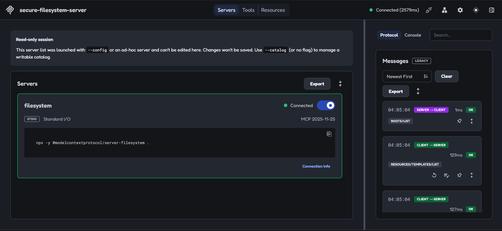

# Práctica 2: Ver el protocolo MCP por dentro

## 1. Descripción

En esta práctica se observan los mensajes JSON-RPC 2.0 que intercambian un cliente y un servidor MCP. Primero con el **MCP Inspector** (un cliente ya hecho, con interfaz web) y después con un **cliente mínimo propio** (`cliente_mcp.mjs`, sin dependencias) que habla con el servidor por stdio. En ambos casos el servidor es `@modelcontextprotocol/server-filesystem`, con acceso a la carpeta de la práctica.

Entorno con el que se trabajó:

| Componente | Versión |
|---|---|
| Sistema operativo | Windows 11 Home (10.0.26200), con PowerShell |
| Node.js | v24.22.1 (npm 11.19.1) |
| MCP Inspector | 2.15.0 (según su interfaz y su `clientInfo`) |
| Servidor | `@modelcontextprotocol/server-filesystem`, que se identifica como `secure-filesystem-server` 2.3.0 en `serverInfo` |

## 2. Requisitos y reproducción

_(Se completa al final de la práctica.)_

## 3. Actividad A: el protocolo visto con el MCP Inspector

Comando usado, desde la carpeta de la práctica:

```powershell
npx -y "@modelcontextprotocol/inspector" --config mcp.json
```

El historial exportado está en [`salida/historial_inspector.json`](salida/historial_inspector.json) y tiene **8 entradas**. El Inspector guarda cada solicitud junto con su respuesta en la misma entrada (campos `message` y `response`), por eso la tabla tiene una fila por solicitud o notificación.

### Mensajes en orden cronológico

| # | Hora (UTC) | Dirección | Método | Tipo | `id` |
|---|---|---|---|---|---|
| 1 | 04:05:02.019 | Cliente → Servidor | `initialize` | Solicitud (con respuesta) | 0 |
| 2 | 04:05:04.385 | Cliente → Servidor | `notifications/initialized` | Notificación | — |
| 3 | 04:05:04.436 | Cliente → Servidor | `resources/list` | Solicitud (con respuesta) | 1 |
| 4 | 04:05:04.436 | Cliente → Servidor | `tools/list` | Solicitud (con respuesta) | 2 |
| 5 | 04:05:04.436 | Cliente → Servidor | `resources/templates/list` | Solicitud (con respuesta) | 3 |
| 6 | 04:05:04.437 | **Servidor → Cliente** | `roots/list` | Solicitud (con respuesta) | 0 |
| 7 | 04:06:55.083 | Cliente → Servidor | `tools/call` (`list_directory`, `path: "datos"`) | Solicitud (con respuesta) | 4 |
| 8 | 04:08:47.051 | Cliente → Servidor | `tools/call` (`read_text_file`, `path: "datos/calificaciones.csv"`) | Solicitud (con respuesta) | 5 |

Los mensajes 3, 4 y 5 tienen la misma marca de tiempo; su orden sale de sus `id` (1, 2, 3). El `id` 0 del mensaje 6 no choca con el del mensaje 1: cada lado numera sus propias solicitudes.

### Datos de la inicialización

| Dato | Valor |
|---|---|
| Versión del protocolo que propuso el cliente | `2025-11-25` |
| Versión del protocolo que aceptó el servidor | `2025-11-25` |
| `serverInfo` | `secure-filesystem-server`, versión `2.3.0` |
| Capacidades del servidor | `tools` (`listChanged: true`) y `resources` (`listChanged: true`) |
| `clientInfo` del Inspector | `mcp-inspector`, versión `2.15.0` |
| Capacidades del cliente (Inspector) | `sampling`, `elicitation` (`form`, `url`), `roots` (`listChanged: true`), `tasks` (`list`, `cancel` y `requests` para `sampling/createMessage` y `elicitation/create`) y `extensions` (`io.modelcontextprotocol/tasks`, `io.modelcontextprotocol/ui`, `io.modelcontextprotocol/skills`) |
| Mensaje en dirección contraria | `roots/list`: el **servidor** le pide al cliente sus carpetas raíz. El Inspector respondió `{"roots": []}` |
| Herramientas que ofrece el servidor | 16 (pestaña *Tools* y respuesta de `tools/list`) |
| Segunda herramienta ejecutada | `read_text_file` con `path: "datos/calificaciones.csv"`. Devolvió el contenido del CSV |

### Capturas

Inspector conectado al servidor. En el panel *Messages* se ve el `roots/list` en dirección Servidor → Cliente:



Ejecución de `list_directory` con `path: "datos"` y su mensaje `tools/call`:


Segunda herramienta: `read_text_file` con `datos/calificaciones.csv`:


Versión del Inspector que muestra su interfaz:


## 4. Actividad B: un cliente MCP mínimo

`cliente_mcp.mjs` se copió de las tres partes de la guía y se ejecutó con `node cliente_mcp.mjs`. Terminó con código de salida 0 y dejó `salida/traza.jsonl` con **7 líneas**: 4 mensajes del cliente y 3 del servidor. La salida completa de la terminal está en [`evidencias/terminal_cliente_B.txt`](evidencias/terminal_cliente_B.txt).

### Los siete mensajes

| # | Dirección | Método o contenido | Tipo de mensaje | `id` | Función del cliente que lo produjo |
|---|---|---|---|---|---|
| 1 | Cliente → Servidor | `initialize` (propone `2025-06-18`, `capabilities: {}`, `clientInfo` `cliente-minimo` 1.0.0) | Solicitud | 1 | `solicitar()` |
| 2 | Servidor → Cliente | `result`: versión `2025-06-18`, capacidades `tools` y `resources`, `serverInfo` `secure-filesystem-server` 2.3.0 | Respuesta | 1 | Lector de líneas (`createInterface`) |
| 3 | Cliente → Servidor | `notifications/initialized` | Notificación | — | `notificar()` |
| 4 | Cliente → Servidor | `tools/list` | Solicitud | 2 | `solicitar()` |
| 5 | Servidor → Cliente | `result.tools`: definición de las 16 herramientas | Respuesta | 2 | Lector de líneas |
| 6 | Cliente → Servidor | `tools/call` con `name: "list_directory"` y `path: "datos"` | Solicitud | 3 | `solicitar()` |
| 7 | Servidor → Cliente | `result.content`: `[FILE] calificaciones.csv` | Respuesta | 3 | Lector de líneas |

**Cómo se empareja cada respuesta con su solicitud:** `solicitar()` asigna un `id` nuevo (`siguienteId++`) y guarda en el mapa `pendientes` la función que resuelve su promesa. Cuando llega una línea del servidor, el lector busca `pendientes.get(mensaje.id)` y la llama. Así cada `await solicitar(...)` termina cuando llega la respuesta con su mismo `id`. La notificación no tiene `id`, no se guarda en `pendientes` y el cliente no espera nada por ella.

Las líneas sueltas de la terminal, como `Secure MCP Filesystem Server running on stdio`, `Effective allowed directories (from the command line): ...` y `Client does not support MCP Roots, ...`, salen del stderr del servidor. No son mensajes del protocolo y no aparecen en la traza: el cliente lanza el servidor con `stdio: ['pipe', 'pipe', 'inherit']`, así que stderr va directo a la terminal y solo stdout se interpreta como JSON-RPC.

### La herramienta `list_directory`

Así la define el servidor en la respuesta a `tools/list`:

- **Descripción:** muestra lo que hay directamente dentro de una carpeta, sin entrar en subcarpetas. Marca cada entrada como `[FILE]` (archivo) o `[DIR]` (carpeta) y devuelve una línea por entrada. La propia descripción recomienda otras herramientas para otros casos: `list_directory_with_sizes` si también quieres tamaños u ordenar por tamaño, y `directory_tree` para ver todo el árbol. Solo funciona dentro de las carpetas permitidas.
- **`inputSchema`:** espera un objeto con un único parámetro obligatorio (`required: ["path"]`), `path`, de tipo texto. Es la carpeta a listar, absoluta o relativa a una carpeta permitida, y debe quedar dentro de las carpetas permitidas.
- **`annotations`:** `readOnlyHint: true` (no modifica nada), `idempotentHint: true` (repetirla con los mismos argumentos no tiene efectos adicionales), `destructiveHint: false` (no borra ni sobrescribe) y `openWorldHint: false` (solo trabaja con un mundo cerrado, el sistema de archivos local permitido, sin servicios externos). Son pistas para el cliente, por ejemplo para decidir si pide confirmación antes de usarla, no garantías.
- Además trae `title: "List Directory"` y un `outputSchema`: el resultado estructurado es un objeto con un campo `content` de tipo texto.

## 5. Actividad C: ampliar la conversación

### Código agregado

En la parte 3 de `cliente_mcp.mjs`, antes del paso 5 (`servidor.stdin.end()`):

```js
// Actividad C.
// Una lectura correcta: archivo dentro de la carpeta permitida.
await solicitar('tools/call', {
  name: 'read_text_file',
  arguments: { path: 'datos/calificaciones.csv' },
});

// Una lectura prohibida: ruta fuera de la carpeta de la practica.
await solicitar('tools/call', {
  name: 'read_text_file',
  arguments: { path: 'C:/Windows/win.ini' },
});

// Un metodo que no existe en el protocolo.
await solicitar('herramientas/inventada', {});
```

Al ejecutar `node cliente_mcp.mjs` (código de salida 0), `salida/traza.jsonl` quedó con **13 líneas**. La salida de la terminal está en [`evidencias/terminal_cliente_C.txt`](evidencias/terminal_cliente_C.txt). Las tres solicitudes nuevas se comportaron así:

| `id` | Solicitud | Resultado |
|---|---|---|
| 4 | `tools/call` `read_text_file` con `datos/calificaciones.csv` | `result` con el contenido completo del CSV |
| 5 | `tools/call` `read_text_file` con `C:/Windows/win.ini` | `result` con `"isError": true` (falla) |
| 6 | `herramientas/inventada` | `error` con código `-32601` (falla) |

> **Nota de privacidad:** el mensaje de error del `id` 5 traía la ruta real de la carpeta de la práctica, con el nombre de usuario del sistema. En `salida/traza.jsonl` y en los archivos `evidencias/terminal_cliente_*.txt` ese nombre se sustituyó por `TU_USUARIO`, como sugiere la guía. Es el único cambio que se hizo a esos archivos.

### Las dos respuestas fallidas (copiadas de la traza)

Respuesta al `id` 5, la lectura prohibida:

```json
{"direccion":"SERVIDOR -> CLIENTE","mensaje":{"result":{"content":[{"type":"text","text":"Access denied - path outside allowed directories: C:\\Windows\\win.ini not in C:\\Users\\TU_USUARIO\\practica2-mcp"}],"isError":true},"jsonrpc":"2.0","id":5}}
```

Respuesta al `id` 6, el método inventado:

```json
{"direccion":"SERVIDOR -> CLIENTE","mensaje":{"jsonrpc":"2.0","id":6,"error":{"code":-32601,"message":"Method not found"}}}
```

### En qué se diferencian

- **`id` 5: error de ejecución de herramienta.** El método `tools/call` existe y los parámetros son válidos, así que el servidor **sí invocó** `read_text_file`. Lo que falló fue el trabajo de la herramienta: la ruta está fuera de las carpetas permitidas. Se reconoce porque la respuesta trae **`result`**, no `error`, con un `content` normal cuyo texto explica el problema ("Access denied - path outside allowed directories") y el campo **`"isError": true`**. Para JSON-RPC esta solicitud se atendió bien. El fallo lo cuenta la herramienta dentro de su resultado, y quien lo lea, por ejemplo un modelo, puede entenderlo y corregirse.
- **`id` 6: error de protocolo.** El servidor **no pudo atender** el mensaje porque `herramientas/inventada` no es un método que conozca, así que no se ejecutó nada. Se reconoce porque la respuesta trae **`error`** en lugar de `result`, con **`code: -32601`** y **`message: "Method not found"`**. Ese código es el que JSON-RPC 2.0 reserva para "método no encontrado".

En los dos casos la respuesta conserva el `id` de su solicitud, así que el cliente las empareja igual que a las respuestas correctas.

## 6. Actividad D: comparar dos clientes

_(Pendiente.)_

## 7. Actividad E: diagrama de secuencia

_(Pendiente.)_

## 8. Problemas encontrados

_(Se completa al final de la práctica.)_

## 9. Fuentes

_(Se completa al final de la práctica.)_
