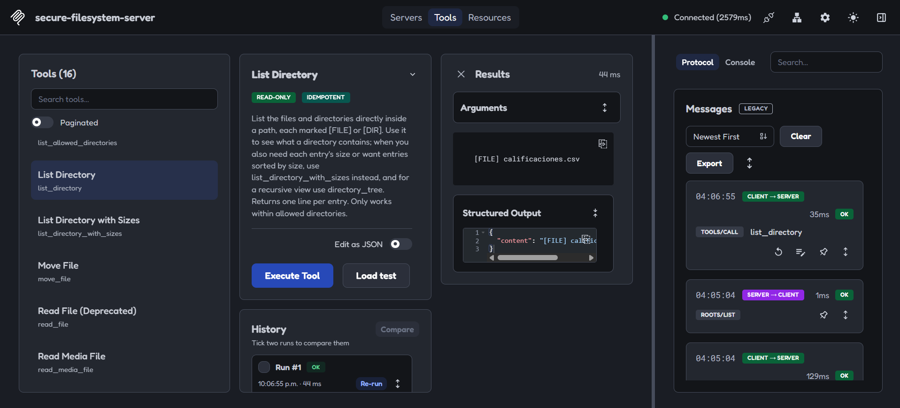

# Práctica 2: Ver el protocolo MCP por dentro

## 1. Descripción

En esta práctica se observan los mensajes JSON-RPC 2.0 que intercambian un cliente y un servidor MCP. Primero con el **MCP Inspector** (un cliente ya hecho, con interfaz web) y después con un **cliente mínimo propio** (`cliente_mcp.mjs`, sin dependencias) que habla con el servidor por stdio. En ambos casos el servidor es `@modelcontextprotocol/server-filesystem`, con acceso a la carpeta de la práctica.

Entorno con el que se trabajó:

| Componente | Versión |
|---|---|
| Sistema operativo | Windows 11 Home (10.0.26200), con PowerShell |
| Node.js | v24.22.1 (npm 11.19.1) |
| MCP Inspector | 2.15.0 (según su interfaz y su `clientInfo`) |
| Servidor | `@modelcontextprotocol/server-filesystem`, que se identifica como `secure-filesystem-server` 2.3.0 en `serverInfo` |

## 2. Requisitos y reproducción

_(Se completa al final de la práctica.)_

## 3. Actividad A: el protocolo visto con el MCP Inspector

Comando usado, desde la carpeta de la práctica:

```powershell
npx -y "@modelcontextprotocol/inspector" --config mcp.json
```

El historial exportado está en [`salida/historial_inspector.json`](salida/historial_inspector.json) y tiene **8 entradas**. El Inspector guarda cada solicitud junto con su respuesta en la misma entrada (campos `message` y `response`), por eso la tabla tiene una fila por solicitud o notificación.

### Mensajes en orden cronológico

| # | Hora (UTC) | Dirección | Método | Tipo | `id` |
|---|---|---|---|---|---|
| 1 | 04:05:02.019 | Cliente → Servidor | `initialize` | Solicitud (con respuesta) | 0 |
| 2 | 04:05:04.385 | Cliente → Servidor | `notifications/initialized` | Notificación | — |
| 3 | 04:05:04.436 | Cliente → Servidor | `resources/list` | Solicitud (con respuesta) | 1 |
| 4 | 04:05:04.436 | Cliente → Servidor | `tools/list` | Solicitud (con respuesta) | 2 |
| 5 | 04:05:04.436 | Cliente → Servidor | `resources/templates/list` | Solicitud (con respuesta) | 3 |
| 6 | 04:05:04.437 | **Servidor → Cliente** | `roots/list` | Solicitud (con respuesta) | 0 |
| 7 | 04:06:55.083 | Cliente → Servidor | `tools/call` (`list_directory`, `path: "datos"`) | Solicitud (con respuesta) | 4 |
| 8 | 04:08:47.051 | Cliente → Servidor | `tools/call` (`read_text_file`, `path: "datos/calificaciones.csv"`) | Solicitud (con respuesta) | 5 |

Los mensajes 3, 4 y 5 tienen la misma marca de tiempo; su orden sale de sus `id` (1, 2, 3). El `id` 0 del mensaje 6 no choca con el del mensaje 1: cada lado numera sus propias solicitudes.

### Datos de la inicialización

| Dato | Valor |
|---|---|
| Versión del protocolo que propuso el cliente | `2025-11-25` |
| Versión del protocolo que aceptó el servidor | `2025-11-25` |
| `serverInfo` | `secure-filesystem-server`, versión `2.3.0` |
| Capacidades del servidor | `tools` (`listChanged: true`) y `resources` (`listChanged: true`) |
| `clientInfo` del Inspector | `mcp-inspector`, versión `2.15.0` |
| Capacidades del cliente (Inspector) | `sampling`, `elicitation` (`form`, `url`), `roots` (`listChanged: true`), `tasks` (`list`, `cancel` y `requests` para `sampling/createMessage` y `elicitation/create`) y `extensions` (`io.modelcontextprotocol/tasks`, `io.modelcontextprotocol/ui`, `io.modelcontextprotocol/skills`) |
| Mensaje en dirección contraria | `roots/list`: el **servidor** le pide al cliente sus carpetas raíz. El Inspector respondió `{"roots": []}` |
| Herramientas que ofrece el servidor | 16 (pestaña *Tools* y respuesta de `tools/list`) |
| Segunda herramienta ejecutada | `read_text_file` con `path: "datos/calificaciones.csv"`. Devolvió el contenido del CSV |

### Capturas

Inspector conectado al servidor. En el panel *Messages* se ve el `roots/list` en dirección Servidor → Cliente:


Ejecución de `list_directory` con `path: "datos"` y su mensaje `tools/call`:



Segunda herramienta: `read_text_file` con `datos/calificaciones.csv`:


Versión del Inspector que muestra su interfaz:


## 4. Actividad B: un cliente MCP mínimo

_(Pendiente.)_

## 5. Actividad C: ampliar la conversación

_(Pendiente.)_

## 6. Actividad D: comparar dos clientes

_(Pendiente.)_

## 7. Actividad E: diagrama de secuencia

_(Pendiente.)_

## 8. Problemas encontrados

_(Se completa al final de la práctica.)_

## 9. Fuentes

_(Se completa al final de la práctica.)_
